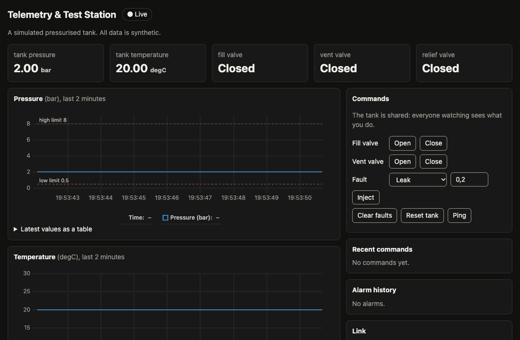
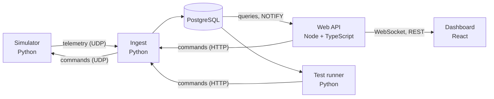

# Telemetry & Test Station

A small ground test station for a **simulated** pressurised tank: live telemetry, commands, alarms
and automated test sequences traced to requirements.



*The tank fills, the relief valve holds the pressure, then it is stuck on purpose and the high
pressure alarm fires. Played at 2.5 times real speed.*

All data is synthetic. This project has no connection to real hardware.

## What it does

- A simulator sends binary telemetry over UDP and accepts commands and injected faults.
- An ingest service checks every packet, counts losses and corruption, stores readings and raises
  alarms. It rides out short database outages.
- A web dashboard shows live values, charts, alarms and the result of each command.
- A test runner executes sequences and reports every requirement as passed, failed, not run or
  **not covered**.

## Architecture



## Run

```bash
docker compose up --build
```

Then open <http://localhost:3000>. Open the fill valve and watch the pressure rise; stick the relief
valve while filling to make the high pressure alarm fire. With the station running, the test
sequences are:

```bash
docker compose run --rm runner
```

## Numbers

Measured on a laptop, with the single-container image and a local database.

| | |
|---|---|
| Telemetry rate | 10 reports a second, 5 parameters each |
| Simulator to WebSocket, 300 reports | median 5 ms, 95th percentile 6 ms |
| Same, limited to 0.1 CPU | median 5 ms, worst 211 ms |
| Automated tests | 128: 105 Python, 14 web API, 5 dashboard, 4 in the browser |

## Documentation

| | |
|---|---|
| [Link protocol](docs/PROTOCOL.md) | Packet layout byte by byte, inspired by CCSDS and ECSS PUS, not compliant |
| [Simulator](docs/SIMULATOR.md) | Behaviour, faults, reproducibility |
| [Ingest](docs/INGEST.md) | Storage, alarms, link counters, outages |
| [Web](docs/WEB.md) | API and dashboard |
| [Testing](docs/TESTING.md) | Sequences, traceability, browser tests |
| [Deploy](docs/DEPLOY.md) | Free hosting |
| [Plan](docs/PLAN.md) | The original plan and its phases |

## Limits

- The physics is a toy, chosen to be watchable.
- No authentication anywhere: the tank is a shared demo.
- A pressure sensor that stops being believable is not detected; the test report says so.

## Develop

Python (3.12), in `station`:

```bash
python3.12 -m venv .venv && . .venv/bin/activate
pip install -e ".[dev]"
ruff check . && ruff format --check . && pytest -q
```

Database tests run when `TEST_DATABASE_URL` points to a database that may be wiped.

Web API and dashboard (Node 22), in `web/api` and again in `web/dashboard`:

```bash
npm ci
npm run typecheck && npm test && npm run build
```
